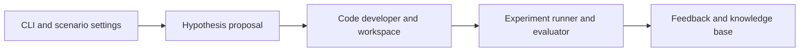
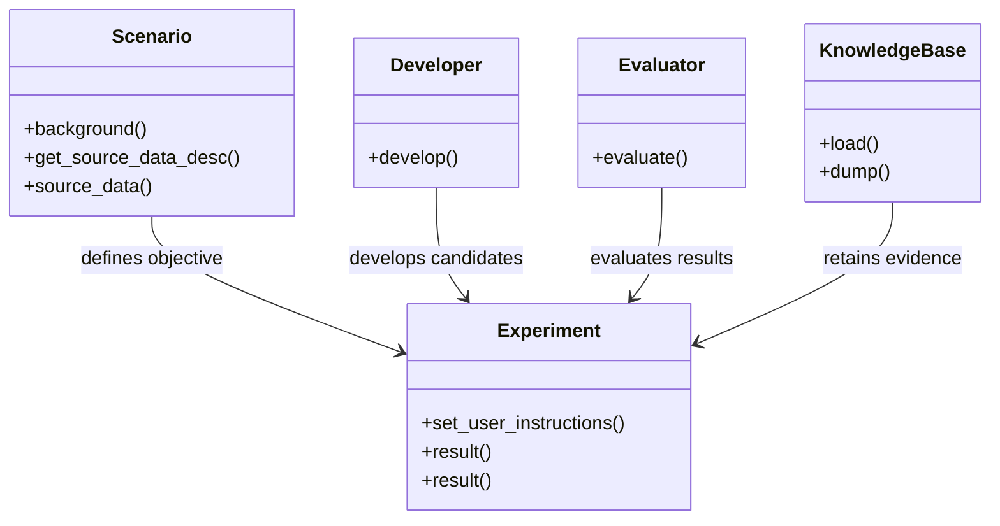
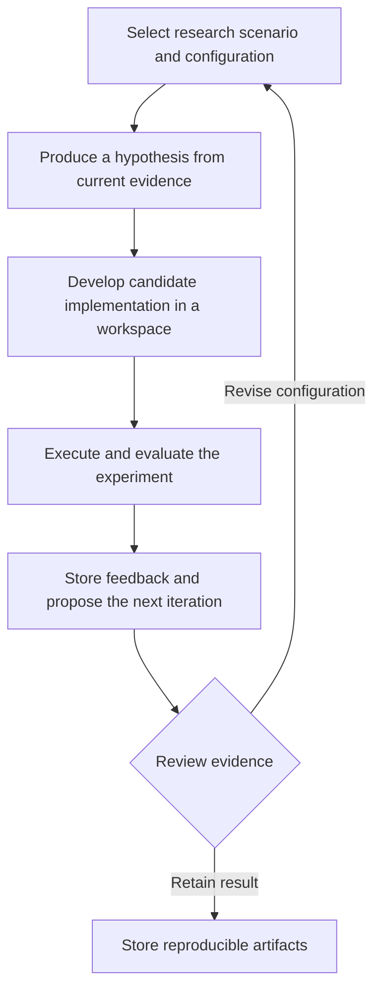
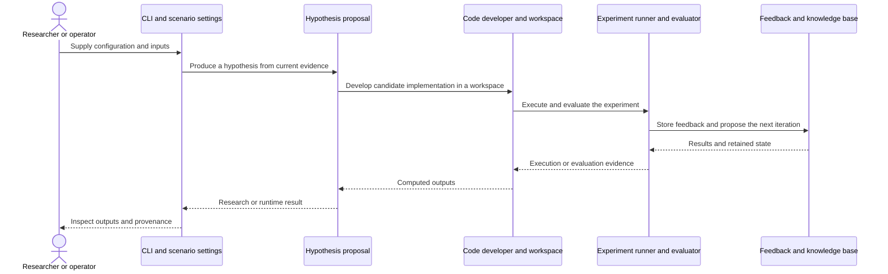
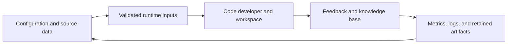
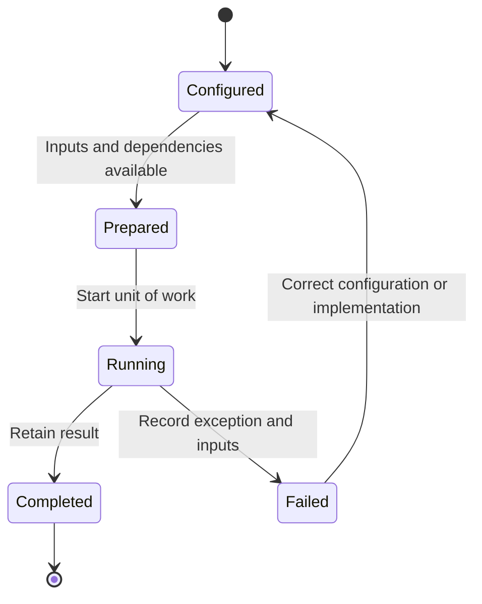

# RD-Agent: workflow and architecture

Updated 2026-10-12. Source baseline: `484776c211e4fbbeef03e0ec00d6bbee7362a4f4` on `feature/ayu_develop`. See [development commands](development.md) and [validation evidence](validation.md) for the tested environment and current limitations.

## Purpose and features

Automates iterative research and development using language-model proposals, generated code, experiment execution, evaluation, and accumulated feedback.

- Financial factor and model research
- Data-science and Kaggle development loops
- CoSTEER code evolution and execution feedback
- Configurable LLM backends and MCP toolsets
- Experiment workspaces, logs, and reusable knowledge

## Component architecture

The research loop keeps scenario-specific objectives separate from proposal, development, and evaluation contracts. This lets financial factor work and general data-science work share iteration machinery while keeping their data and scoring rules distinct. Generated code executes in an experiment workspace rather than becoming the library implementation automatically. Feedback is an input to subsequent attempts, so experiment provenance and persistent logs are part of the design, not only debugging aids.

The diagram shows responsibility boundaries in the main research or execution path. Concrete entry points and implementation files are linked below.

## Core types

The types below belong to the public or native boundary described by the linked implementation. Arrows describe the dependency or ownership relationship used in the documented workflow. Listed Python methods are present in the linked source; native array types represent the binding boundary.

## End-to-end workflow

1. Select research scenario and configuration.
2. Produce a hypothesis from current evidence.
3. Develop candidate implementation in a workspace.
4. Execute and evaluate the experiment.
5. Store feedback and propose the next iteration.

## Interaction sequence

The sequence follows one unit of work. Results return across the same boundaries that accepted the configuration and data. External I/O and numerical execution have different failure modes and should retain separate evidence.

## Data and artifact lifecycle

Inputs include explicit strategy or model settings, data selection, and execution assumptions. Retaining these with outputs makes a rerun reviewable. Temporary environments and caches remain development artifacts, while source-controlled configuration documents intended behavior.

## Execution and failure boundaries

LLM requests, MCP servers, Docker execution, and remote datasets are external boundaries. Model selection and credentials come from settings. Prefect caching optionally persists agent results. A successful package build proves installation, while API and container tests also require the configured services.

This state diagram describes the documented workflow, not a claim that these names are an implementation enum. Failure evidence should identify whether input preparation, external services, native compilation, or application execution failed.

## Development layout

The upstream rdagent/ package remains flat because scenario workspaces, templates, tooling, and package-relative assets use its established paths. Setuptools discovers all rdagent subpackages. Dependencies remain declared through the upstream requirements files, and uv.lock records exact resolved versions.

## Source map

| Existing source | Responsibility evidence |
|---|---|
| [rdagent/app/cli.py](../rdagent/app/cli.py#L45) | Implementation and module/type documentation, beginning at line 45 |
| [rdagent/core/scenario.py](../rdagent/core/scenario.py#L6) | Implementation and module/type documentation, beginning at line 6 |
| [rdagent/core/experiment.py](../rdagent/core/experiment.py#L34) | Implementation and module/type documentation, beginning at line 34 |
| [rdagent/core/developer.py](../rdagent/core/developer.py#L12) | Implementation and module/type documentation, beginning at line 12 |
| [rdagent/core/evaluation.py](../rdagent/core/evaluation.py#L8) | Implementation and module/type documentation, beginning at line 8 |
| [rdagent/core/proposal.py](../rdagent/core/proposal.py#L24) | Implementation and module/type documentation, beginning at line 24 |
| [rdagent/core/knowledge_base.py](../rdagent/core/knowledge_base.py#L10) | Implementation and module/type documentation, beginning at line 10 |
| [rdagent/core/evolving_framework.py](../rdagent/core/evolving_framework.py#L17) | Implementation and module/type documentation, beginning at line 17 |
| [rdagent/app/data_science/loop.py](../rdagent/app/data_science/loop.py#L13) | Implementation and module/type documentation, beginning at line 13 |
| [rdagent/oai/backend/pydantic_ai.py](../rdagent/oai/backend/pydantic_ai.py#L27) | Implementation and module/type documentation, beginning at line 27 |
| [rdagent/components/agent/base.py](../rdagent/components/agent/base.py#L12) | Implementation and module/type documentation, beginning at line 12 |
| [rdagent/components/agent/context7/__init__.py](../rdagent/components/agent/context7/__init__.py#L11) | Implementation and module/type documentation, beginning at line 11 |

The links target files present in this checkout. Follow their imports and adjacent tests when changing a boundary. The validation document distinguishes successful builds, complete test runs, inherited skips, and unresolved prerequisites.
