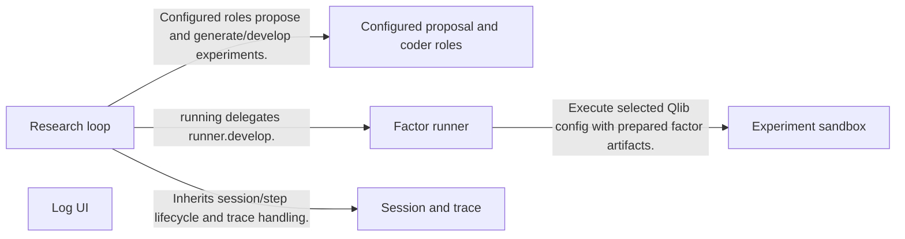
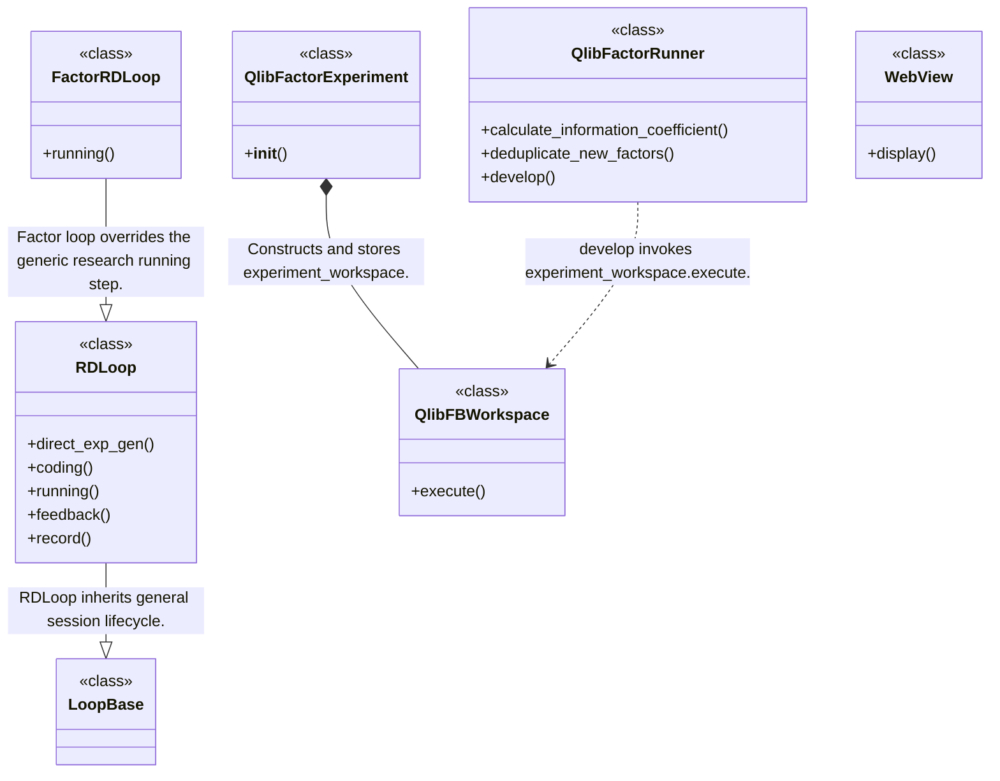
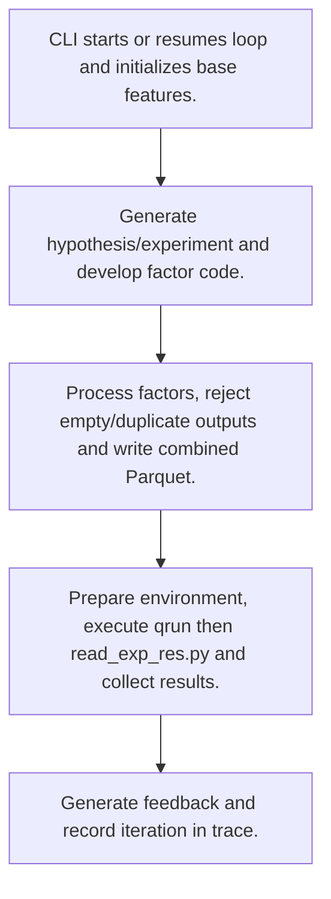
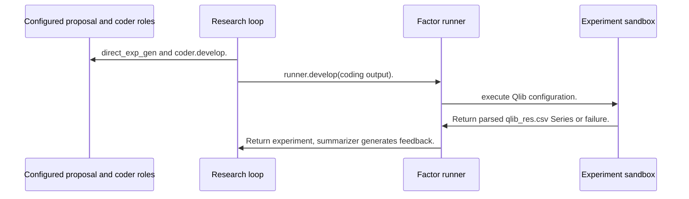

# RD-Agent: workflow, design and architecture

Updated: **2026-10-13**
Reviewed Git hash: `163612660c7e8296531629743b04c7b01ba641fc`
Branch: `feature/ayu_develop`
Source diff SHA256: `e3b0c44298fc1c149afbf4c8996fb92427ae41e4649b934ca495991b7852b855`
Scope: **Agent research platform** / Maintenance: **active**
Languages: Python

[HTML edition](ayu-develop.html) / [Development](development.md) / [Historical validation](validation.md) / [Full system comparison](../../docs/index.html)

## Purpose and scope

Iterative hypothesis, generated-code, experiment execution and feedback workflows, with Qlib factor/model research as one scenario and separate RL post-training workflows.

## Features and support boundaries

Native = implemented here. Integration = supplied through a named host/API. Limited = material restriction. Not provided = evidenced scope exclusion. Unverified = support/absence not established. Not applicable = outside this artifact type.

| Capability | Status | Implementation and limits | Source |
|---|---|---|---|
| Backtesting | Integration | Qlib scenario writes factor features, invokes qrun and loads return/result artifacts; training, portfolio simulation and market data are supplied by Qlib/environment templates. | [QlibFactorRunner](../rdagent/scenarios/qlib/developer/factor_runner.py) ([L25](https://github.com/alexcwyu/RD-Agent/blob/163612660c7e8296531629743b04c7b01ba641fc/rdagent/scenarios/qlib/developer/factor_runner.py#L25)) / [QlibFBWorkspace](../rdagent/scenarios/qlib/experiment/workspace.py) ([L13](https://github.com/alexcwyu/RD-Agent/blob/163612660c7e8296531629743b04c7b01ba641fc/rdagent/scenarios/qlib/experiment/workspace.py#L13)) |
| Live execution | Unverified | Not established by the inspected implementation boundaries; no absence or production claim is made. | Not applicable to this repository scope. |
| Paper trading | Unverified | Not established by the inspected implementation boundaries; no absence or production claim is made. | Not applicable to this repository scope. |
| Event driven | Unverified | Not established by the inspected implementation boundaries; no absence or production claim is made. | Not applicable to this repository scope. |
| Vectorized | Unverified | Not established by the inspected implementation boundaries; no absence or production claim is made. | Not applicable to this repository scope. |
| Order management | Unverified | Not established by the inspected implementation boundaries; no absence or production claim is made. | Not applicable to this repository scope. |
| Order types | Unverified | Not established by the inspected implementation boundaries; no absence or production claim is made. | Not applicable to this repository scope. |
| Multi venue | Unverified | Not established by the inspected implementation boundaries; no absence or production claim is made. | Not applicable to this repository scope. |
| Crypto | Unverified | Not established by the inspected implementation boundaries; no absence or production claim is made. | Not applicable to this repository scope. |
| Equities | Unverified | Not established by the inspected implementation boundaries; no absence or production claim is made. | Not applicable to this repository scope. |
| Futures | Unverified | Not established by the inspected implementation boundaries; no absence or production claim is made. | Not applicable to this repository scope. |
| Options | Unverified | Not established by the inspected implementation boundaries; no absence or production claim is made. | Not applicable to this repository scope. |
| Forex | Unverified | Not established by the inspected implementation boundaries; no absence or production claim is made. | Not applicable to this repository scope. |
| Strategy api | Limited | Native research workflow hooks generate experiments; Qlib strategy configuration/execution is an external integration rather than a native trading strategy lifecycle. | [RDLoop](../rdagent/components/workflow/rd_loop.py) ([L31](https://github.com/alexcwyu/RD-Agent/blob/163612660c7e8296531629743b04c7b01ba641fc/rdagent/components/workflow/rd_loop.py#L31)) / [QlibFBWorkspace](../rdagent/scenarios/qlib/experiment/workspace.py) ([L13](https://github.com/alexcwyu/RD-Agent/blob/163612660c7e8296531629743b04c7b01ba641fc/rdagent/scenarios/qlib/experiment/workspace.py#L13)) |
| Optimization | Limited | Iterative hypothesis/code feedback searches research ideas and deduplicates features; this is not a native exhaustive strategy parameter optimizer. | [RDLoop](../rdagent/components/workflow/rd_loop.py) ([L31](https://github.com/alexcwyu/RD-Agent/blob/163612660c7e8296531629743b04c7b01ba641fc/rdagent/components/workflow/rd_loop.py#L31)) / [QlibFactorRunner](../rdagent/scenarios/qlib/developer/factor_runner.py) ([L25](https://github.com/alexcwyu/RD-Agent/blob/163612660c7e8296531629743b04c7b01ba641fc/rdagent/scenarios/qlib/developer/factor_runner.py#L25)) |
| Machine learning | Integration | Qlib scenario writes factor features, invokes qrun and loads return/result artifacts; training, portfolio simulation and market data are supplied by Qlib/environment templates. | [QlibFactorRunner](../rdagent/scenarios/qlib/developer/factor_runner.py) ([L25](https://github.com/alexcwyu/RD-Agent/blob/163612660c7e8296531629743b04c7b01ba641fc/rdagent/scenarios/qlib/developer/factor_runner.py#L25)) / [QlibFBWorkspace](../rdagent/scenarios/qlib/experiment/workspace.py) ([L13](https://github.com/alexcwyu/RD-Agent/blob/163612660c7e8296531629743b04c7b01ba641fc/rdagent/scenarios/qlib/experiment/workspace.py#L13)) |
| Reinforcement learning | Limited | Actual RLPostTrainingRDLoop supports general RL post-training R&D; finance/trading RL policy execution is not established by that class. | [RLPostTrainingRDLoop](../rdagent/scenarios/rl/loop.py) ([L13](https://github.com/alexcwyu/RD-Agent/blob/163612660c7e8296531629743b04c7b01ba641fc/rdagent/scenarios/rl/loop.py#L13)) |
| Portfolio | Integration | Qlib scenario writes factor features, invokes qrun and loads return/result artifacts; training, portfolio simulation and market data are supplied by Qlib/environment templates. | [QlibFactorRunner](../rdagent/scenarios/qlib/developer/factor_runner.py) ([L25](https://github.com/alexcwyu/RD-Agent/blob/163612660c7e8296531629743b04c7b01ba641fc/rdagent/scenarios/qlib/developer/factor_runner.py#L25)) / [QlibFBWorkspace](../rdagent/scenarios/qlib/experiment/workspace.py) ([L13](https://github.com/alexcwyu/RD-Agent/blob/163612660c7e8296531629743b04c7b01ba641fc/rdagent/scenarios/qlib/experiment/workspace.py#L13)) |
| Risk management | Unverified | Not established by the inspected implementation boundaries; no absence or production claim is made. | Not applicable to this repository scope. |
| Performance analytics | Integration | Qlib scenario writes factor features, invokes qrun and loads return/result artifacts; training, portfolio simulation and market data are supplied by Qlib/environment templates. | [QlibFactorRunner](../rdagent/scenarios/qlib/developer/factor_runner.py) ([L25](https://github.com/alexcwyu/RD-Agent/blob/163612660c7e8296531629743b04c7b01ba641fc/rdagent/scenarios/qlib/developer/factor_runner.py#L25)) / [QlibFBWorkspace](../rdagent/scenarios/qlib/experiment/workspace.py) ([L13](https://github.com/alexcwyu/RD-Agent/blob/163612660c7e8296531629743b04c7b01ba641fc/rdagent/scenarios/qlib/experiment/workspace.py#L13)) |
| Historical data | Integration | Qlib scenario writes factor features, invokes qrun and loads return/result artifacts; training, portfolio simulation and market data are supplied by Qlib/environment templates. | [QlibFactorRunner](../rdagent/scenarios/qlib/developer/factor_runner.py) ([L25](https://github.com/alexcwyu/RD-Agent/blob/163612660c7e8296531629743b04c7b01ba641fc/rdagent/scenarios/qlib/developer/factor_runner.py#L25)) / [QlibFBWorkspace](../rdagent/scenarios/qlib/experiment/workspace.py) ([L13](https://github.com/alexcwyu/RD-Agent/blob/163612660c7e8296531629743b04c7b01ba641fc/rdagent/scenarios/qlib/experiment/workspace.py#L13)) |
| Streaming data | Unverified | Not established by the inspected implementation boundaries; no absence or production claim is made. | Not applicable to this repository scope. |
| Persistence | Native | Session resume/tracing and Streamlit Storage message viewers exist; UI is research/logging oriented. | [LoopBase](../rdagent/utils/workflow/loop.py) ([L86](https://github.com/alexcwyu/RD-Agent/blob/163612660c7e8296531629743b04c7b01ba641fc/rdagent/utils/workflow/loop.py#L86)) / [WebView](../rdagent/log/ui/web.py) ([L29](https://github.com/alexcwyu/RD-Agent/blob/163612660c7e8296531629743b04c7b01ba641fc/rdagent/log/ui/web.py#L29)) / [main](../rdagent/app/qlib_rd_loop/factor.py) ([L30](https://github.com/alexcwyu/RD-Agent/blob/163612660c7e8296531629743b04c7b01ba641fc/rdagent/app/qlib_rd_loop/factor.py#L30)) |
| Data pipeline | Native | Runner processes, deduplicates and persists feature arrays to Parquet before experiment execution. | [QlibFactorRunner](../rdagent/scenarios/qlib/developer/factor_runner.py) ([L25](https://github.com/alexcwyu/RD-Agent/blob/163612660c7e8296531629743b04c7b01ba641fc/rdagent/scenarios/qlib/developer/factor_runner.py#L25)) |
| Web ui | Native | Session resume/tracing and Streamlit Storage message viewers exist; UI is research/logging oriented. | [LoopBase](../rdagent/utils/workflow/loop.py) ([L86](https://github.com/alexcwyu/RD-Agent/blob/163612660c7e8296531629743b04c7b01ba641fc/rdagent/utils/workflow/loop.py#L86)) / [WebView](../rdagent/log/ui/web.py) ([L29](https://github.com/alexcwyu/RD-Agent/blob/163612660c7e8296531629743b04c7b01ba641fc/rdagent/log/ui/web.py#L29)) / [main](../rdagent/app/qlib_rd_loop/factor.py) ([L30](https://github.com/alexcwyu/RD-Agent/blob/163612660c7e8296531629743b04c7b01ba641fc/rdagent/app/qlib_rd_loop/factor.py#L30)) |
| Cli | Native | Fire entrypoint starts/resumes factor loop with explicit execution bounds. | [main](../rdagent/app/qlib_rd_loop/factor.py) ([L30](https://github.com/alexcwyu/RD-Agent/blob/163612660c7e8296531629743b04c7b01ba641fc/rdagent/app/qlib_rd_loop/factor.py#L30)) |
| Monitoring | Native | Session resume/tracing and Streamlit Storage message viewers exist; UI is research/logging oriented. | [LoopBase](../rdagent/utils/workflow/loop.py) ([L86](https://github.com/alexcwyu/RD-Agent/blob/163612660c7e8296531629743b04c7b01ba641fc/rdagent/utils/workflow/loop.py#L86)) / [WebView](../rdagent/log/ui/web.py) ([L29](https://github.com/alexcwyu/RD-Agent/blob/163612660c7e8296531629743b04c7b01ba641fc/rdagent/log/ui/web.py#L29)) / [main](../rdagent/app/qlib_rd_loop/factor.py) ([L30](https://github.com/alexcwyu/RD-Agent/blob/163612660c7e8296531629743b04c7b01ba641fc/rdagent/app/qlib_rd_loop/factor.py#L30)) |
| Extension api | Native | Configured scenario/proposal/developer/runner/summarizer classes extend research loops. | [RDLoop](../rdagent/components/workflow/rd_loop.py) ([L31](https://github.com/alexcwyu/RD-Agent/blob/163612660c7e8296531629743b04c7b01ba641fc/rdagent/components/workflow/rd_loop.py#L31)) |
| Native acceleration | Unverified | Not established by the inspected implementation boundaries; no absence or production claim is made. | Not applicable to this repository scope. |
| Distributed execution | Limited | Parallel-loop admission and external environments are present, but a multi-machine scheduler/deployment was not verified. | [direct_exp_gen](../rdagent/components/workflow/rd_loop.py) ([L199](https://github.com/alexcwyu/RD-Agent/blob/163612660c7e8296531629743b04c7b01ba641fc/rdagent/components/workflow/rd_loop.py#L199)) / [QlibFBWorkspace](../rdagent/scenarios/qlib/experiment/workspace.py) ([L13](https://github.com/alexcwyu/RD-Agent/blob/163612660c7e8296531629743b04c7b01ba641fc/rdagent/scenarios/qlib/experiment/workspace.py#L13)) |

## System components

| Component | Responsibility | Source |
|---|---|---|
| Research loop | Coordinates hypothesis, coding, execution and feedback roles. | [RDLoop](../rdagent/components/workflow/rd_loop.py) ([L31](https://github.com/alexcwyu/RD-Agent/blob/163612660c7e8296531629743b04c7b01ba641fc/rdagent/components/workflow/rd_loop.py#L31)) / [direct_exp_gen](../rdagent/components/workflow/rd_loop.py) ([L199](https://github.com/alexcwyu/RD-Agent/blob/163612660c7e8296531629743b04c7b01ba641fc/rdagent/components/workflow/rd_loop.py#L199)) / [FactorRDLoop](../rdagent/app/qlib_rd_loop/factor.py) ([L17](https://github.com/alexcwyu/RD-Agent/blob/163612660c7e8296531629743b04c7b01ba641fc/rdagent/app/qlib_rd_loop/factor.py#L17)) |
| Configured proposal and coder roles | RDLoop dynamically constructs and invokes hypothesis generator, experiment generator and developer. | [RDLoop](../rdagent/components/workflow/rd_loop.py) ([L31](https://github.com/alexcwyu/RD-Agent/blob/163612660c7e8296531629743b04c7b01ba641fc/rdagent/components/workflow/rd_loop.py#L31)) / [direct_exp_gen](../rdagent/components/workflow/rd_loop.py) ([L199](https://github.com/alexcwyu/RD-Agent/blob/163612660c7e8296531629743b04c7b01ba641fc/rdagent/components/workflow/rd_loop.py#L199)) |
| Factor runner | Processes and deduplicates factors and selects experiment configuration. | [QlibFactorRunner](../rdagent/scenarios/qlib/developer/factor_runner.py) ([L25](https://github.com/alexcwyu/RD-Agent/blob/163612660c7e8296531629743b04c7b01ba641fc/rdagent/scenarios/qlib/developer/factor_runner.py#L25)) |
| Experiment sandbox | Runs Qlib externally in configured Docker/Conda and reads artifact results. | [QlibFBWorkspace](../rdagent/scenarios/qlib/experiment/workspace.py) ([L13](https://github.com/alexcwyu/RD-Agent/blob/163612660c7e8296531629743b04c7b01ba641fc/rdagent/scenarios/qlib/experiment/workspace.py#L13)) / [QlibFactorExperiment](../rdagent/scenarios/qlib/experiment/factor_experiment.py) ([L19](https://github.com/alexcwyu/RD-Agent/blob/163612660c7e8296531629743b04c7b01ba641fc/rdagent/scenarios/qlib/experiment/factor_experiment.py#L19)) |
| Session and trace | Tracks step lifecycle and resume state. | [LoopBase](../rdagent/utils/workflow/loop.py) ([L86](https://github.com/alexcwyu/RD-Agent/blob/163612660c7e8296531629743b04c7b01ba641fc/rdagent/utils/workflow/loop.py#L86)) |
| Log UI | Displays Storage messages in Streamlit. | [WebView](../rdagent/log/ui/web.py) ([L29](https://github.com/alexcwyu/RD-Agent/blob/163612660c7e8296531629743b04c7b01ba641fc/rdagent/log/ui/web.py#L29)) |

## Architecture and component boundaries

The component view summarizes inspected responsibility boundaries. Arrows identify the documented API/data dependencies; this is not a deployment-readiness claim.

- Configured roles propose and generate/develop experiments.: [RDLoop](../rdagent/components/workflow/rd_loop.py) ([L31](https://github.com/alexcwyu/RD-Agent/blob/163612660c7e8296531629743b04c7b01ba641fc/rdagent/components/workflow/rd_loop.py#L31)) / [direct_exp_gen](../rdagent/components/workflow/rd_loop.py) ([L199](https://github.com/alexcwyu/RD-Agent/blob/163612660c7e8296531629743b04c7b01ba641fc/rdagent/components/workflow/rd_loop.py#L199))
- running delegates runner.develop.: [FactorRDLoop](../rdagent/app/qlib_rd_loop/factor.py) ([L17](https://github.com/alexcwyu/RD-Agent/blob/163612660c7e8296531629743b04c7b01ba641fc/rdagent/app/qlib_rd_loop/factor.py#L17))
- Execute selected Qlib config with prepared factor artifacts.: [QlibFactorRunner](../rdagent/scenarios/qlib/developer/factor_runner.py) ([L25](https://github.com/alexcwyu/RD-Agent/blob/163612660c7e8296531629743b04c7b01ba641fc/rdagent/scenarios/qlib/developer/factor_runner.py#L25)) / [QlibFBWorkspace](../rdagent/scenarios/qlib/experiment/workspace.py) ([L13](https://github.com/alexcwyu/RD-Agent/blob/163612660c7e8296531629743b04c7b01ba641fc/rdagent/scenarios/qlib/experiment/workspace.py#L13))
- Inherits session/step lifecycle and trace handling.: [RDLoop](../rdagent/components/workflow/rd_loop.py) ([L31](https://github.com/alexcwyu/RD-Agent/blob/163612660c7e8296531629743b04c7b01ba641fc/rdagent/components/workflow/rd_loop.py#L31)) / [LoopBase](../rdagent/utils/workflow/loop.py) ([L86](https://github.com/alexcwyu/RD-Agent/blob/163612660c7e8296531629743b04c7b01ba641fc/rdagent/utils/workflow/loop.py#L86))

## Design decisions

| Decision | Rationale | Tradeoff | Evidence |
|---|---|---|---|
| Keep research roles configurable rather than hard-coded. | Scenario-specific proposal/coder/runner/summarizer can share iterative workflow machinery. | Behavior depends on configured implementations and external credentials/environments. | [RDLoop](../rdagent/components/workflow/rd_loop.py) ([L31](https://github.com/alexcwyu/RD-Agent/blob/163612660c7e8296531629743b04c7b01ba641fc/rdagent/components/workflow/rd_loop.py#L31)) |
| Exchange factor data via Parquet artifacts. | Runner documents cross-environment NumPy pickle compatibility and writes combined factors to Parquet. | Artifact schemas/environment templates remain integration contracts. | [QlibFactorRunner](../rdagent/scenarios/qlib/developer/factor_runner.py) ([L25](https://github.com/alexcwyu/RD-Agent/blob/163612660c7e8296531629743b04c7b01ba641fc/rdagent/scenarios/qlib/developer/factor_runner.py#L25)) / [QlibFBWorkspace](../rdagent/scenarios/qlib/experiment/workspace.py) ([L13](https://github.com/alexcwyu/RD-Agent/blob/163612660c7e8296531629743b04c7b01ba641fc/rdagent/scenarios/qlib/experiment/workspace.py#L13)) |

## Class and interface relationships

Each node is a reviewed source symbol. Function/module nodes are explicitly labeled; they do not imply Python classes. Only reviewed relationships are drawn.

- **RDLoop** (class): [RDLoop](../rdagent/components/workflow/rd_loop.py) ([L31](https://github.com/alexcwyu/RD-Agent/blob/163612660c7e8296531629743b04c7b01ba641fc/rdagent/components/workflow/rd_loop.py#L31)) / [direct_exp_gen](../rdagent/components/workflow/rd_loop.py) ([L199](https://github.com/alexcwyu/RD-Agent/blob/163612660c7e8296531629743b04c7b01ba641fc/rdagent/components/workflow/rd_loop.py#L199))
- **FactorRDLoop** (class): [FactorRDLoop](../rdagent/app/qlib_rd_loop/factor.py) ([L17](https://github.com/alexcwyu/RD-Agent/blob/163612660c7e8296531629743b04c7b01ba641fc/rdagent/app/qlib_rd_loop/factor.py#L17))
- **QlibFactorRunner** (class): [QlibFactorRunner](../rdagent/scenarios/qlib/developer/factor_runner.py) ([L25](https://github.com/alexcwyu/RD-Agent/blob/163612660c7e8296531629743b04c7b01ba641fc/rdagent/scenarios/qlib/developer/factor_runner.py#L25))
- **QlibFBWorkspace** (class): [QlibFBWorkspace](../rdagent/scenarios/qlib/experiment/workspace.py) ([L13](https://github.com/alexcwyu/RD-Agent/blob/163612660c7e8296531629743b04c7b01ba641fc/rdagent/scenarios/qlib/experiment/workspace.py#L13))
- **QlibFactorExperiment** (class): [QlibFactorExperiment](../rdagent/scenarios/qlib/experiment/factor_experiment.py) ([L19](https://github.com/alexcwyu/RD-Agent/blob/163612660c7e8296531629743b04c7b01ba641fc/rdagent/scenarios/qlib/experiment/factor_experiment.py#L19))
- **LoopBase** (class): [LoopBase](../rdagent/utils/workflow/loop.py) ([L86](https://github.com/alexcwyu/RD-Agent/blob/163612660c7e8296531629743b04c7b01ba641fc/rdagent/utils/workflow/loop.py#L86))
- **WebView** (class): [WebView](../rdagent/log/ui/web.py) ([L29](https://github.com/alexcwyu/RD-Agent/blob/163612660c7e8296531629743b04c7b01ba641fc/rdagent/log/ui/web.py#L29))

## Workflow

### Qlib factor R&D iteration

Qlib training/backtesting is an external integration invoked via qrun inside Docker/Conda; it is not a native broker simulator. Roles are configured objects whose complete implementations are outside this representative trace.

1. CLI starts or resumes loop and initializes base features.. [main](../rdagent/app/qlib_rd_loop/factor.py) ([L30](https://github.com/alexcwyu/RD-Agent/blob/163612660c7e8296531629743b04c7b01ba641fc/rdagent/app/qlib_rd_loop/factor.py#L30))
2. Generate hypothesis/experiment and develop factor code.. [direct_exp_gen](../rdagent/components/workflow/rd_loop.py) ([L199](https://github.com/alexcwyu/RD-Agent/blob/163612660c7e8296531629743b04c7b01ba641fc/rdagent/components/workflow/rd_loop.py#L199)) / [RDLoop](../rdagent/components/workflow/rd_loop.py) ([L31](https://github.com/alexcwyu/RD-Agent/blob/163612660c7e8296531629743b04c7b01ba641fc/rdagent/components/workflow/rd_loop.py#L31))
3. Process factors, reject empty/duplicate outputs and write combined Parquet.. [QlibFactorRunner](../rdagent/scenarios/qlib/developer/factor_runner.py) ([L25](https://github.com/alexcwyu/RD-Agent/blob/163612660c7e8296531629743b04c7b01ba641fc/rdagent/scenarios/qlib/developer/factor_runner.py#L25))
4. Prepare environment, execute qrun then read_exp_res.py and collect results.. [QlibFBWorkspace](../rdagent/scenarios/qlib/experiment/workspace.py) ([L13](https://github.com/alexcwyu/RD-Agent/blob/163612660c7e8296531629743b04c7b01ba641fc/rdagent/scenarios/qlib/experiment/workspace.py#L13))
5. Generate feedback and record iteration in trace.. [direct_exp_gen](../rdagent/components/workflow/rd_loop.py) ([L199](https://github.com/alexcwyu/RD-Agent/blob/163612660c7e8296531629743b04c7b01ba641fc/rdagent/components/workflow/rd_loop.py#L199)) / [RDLoop](../rdagent/components/workflow/rd_loop.py) ([L31](https://github.com/alexcwyu/RD-Agent/blob/163612660c7e8296531629743b04c7b01ba641fc/rdagent/components/workflow/rd_loop.py#L31))

## Sequence

Qlib factor R&D iteration

Qlib training/backtesting is an external integration invoked via qrun inside Docker/Conda; it is not a native broker simulator. Roles are configured objects whose complete implementations are outside this representative trace.

- direct_exp_gen and coder.develop.: [direct_exp_gen](../rdagent/components/workflow/rd_loop.py) ([L199](https://github.com/alexcwyu/RD-Agent/blob/163612660c7e8296531629743b04c7b01ba641fc/rdagent/components/workflow/rd_loop.py#L199))
- runner.develop(coding output).: [FactorRDLoop](../rdagent/app/qlib_rd_loop/factor.py) ([L17](https://github.com/alexcwyu/RD-Agent/blob/163612660c7e8296531629743b04c7b01ba641fc/rdagent/app/qlib_rd_loop/factor.py#L17))
- execute Qlib configuration.: [QlibFactorRunner](../rdagent/scenarios/qlib/developer/factor_runner.py) ([L25](https://github.com/alexcwyu/RD-Agent/blob/163612660c7e8296531629743b04c7b01ba641fc/rdagent/scenarios/qlib/developer/factor_runner.py#L25))
- Return parsed qlib_res.csv Series or failure.: [QlibFBWorkspace](../rdagent/scenarios/qlib/experiment/workspace.py) ([L13](https://github.com/alexcwyu/RD-Agent/blob/163612660c7e8296531629743b04c7b01ba641fc/rdagent/scenarios/qlib/experiment/workspace.py#L13))
- Return experiment; summarizer generates feedback.: [direct_exp_gen](../rdagent/components/workflow/rd_loop.py) ([L199](https://github.com/alexcwyu/RD-Agent/blob/163612660c7e8296531629743b04c7b01ba641fc/rdagent/components/workflow/rd_loop.py#L199)) / [FactorRDLoop](../rdagent/app/qlib_rd_loop/factor.py) ([L17](https://github.com/alexcwyu/RD-Agent/blob/163612660c7e8296531629743b04c7b01ba641fc/rdagent/app/qlib_rd_loop/factor.py#L17))

## Strengths and limits

### Strengths

- Empty or overly correlated newly generated factors are explicitly rejected before experiment evaluation. [QlibFactorRunner](../rdagent/scenarios/qlib/developer/factor_runner.py) ([L25](https://github.com/alexcwyu/RD-Agent/blob/163612660c7e8296531629743b04c7b01ba641fc/rdagent/scenarios/qlib/developer/factor_runner.py#L25))

### Limitations

- Agent R&D automation is not live order execution; no exchange/account/order workflow is established in the reviewed research path. [QlibFBWorkspace](../rdagent/scenarios/qlib/experiment/workspace.py) ([L13](https://github.com/alexcwyu/RD-Agent/blob/163612660c7e8296531629743b04c7b01ba641fc/rdagent/scenarios/qlib/experiment/workspace.py#L13)) / [RDLoop](../rdagent/components/workflow/rd_loop.py) ([L31](https://github.com/alexcwyu/RD-Agent/blob/163612660c7e8296531629743b04c7b01ba641fc/rdagent/components/workflow/rd_loop.py#L31))
- Recorded credentials/MCP/Kaggle failures and configured environment prerequisites remain observable despite current completion exclusions. [docs/validation.md](../docs/validation.md) ([L16](https://github.com/alexcwyu/RD-Agent/blob/163612660c7e8296531629743b04c7b01ba641fc/docs/validation.md#L10))

## Validation scope

The linked validation and command records preserve actual historical runs and user-authorized exclusions. This source/document review does not rerun application tests, establish live trading readiness or rank benchmark performance. Current data, credential and runtime prerequisites remain material.

[Repository validation](validation.md) / [Executed checks](maintenance/index.md)

## Source map

| Reviewed symbol/path | Inspected responsibility | Actual file SHA256 |
|---|---|---|
| [RDLoop](../rdagent/components/workflow/rd_loop.py) ([L31](https://github.com/alexcwyu/RD-Agent/blob/163612660c7e8296531629743b04c7b01ba641fc/rdagent/components/workflow/rd_loop.py#L31)) | Imports configured scenario/proposal/coder/runner/summarizer classes and owns the trace; steps generate experiments, develop code, run it and summarize feedback. | `eb858b5e258f5a0f1a8c475e852bdae87c492b2765e7f2c52cb629e4240ae901` |
| [direct_exp_gen](../rdagent/components/workflow/rd_loop.py) ([L199](https://github.com/alexcwyu/RD-Agent/blob/163612660c7e8296531629743b04c7b01ba641fc/rdagent/components/workflow/rd_loop.py#L199)) | Waits below the configured parallel-loop cap, proposes hypothesis, generates an experiment and injects selected feature expressions/codes; coding/running/feedback steps delegate to configured roles. | `eb858b5e258f5a0f1a8c475e852bdae87c492b2765e7f2c52cb629e4240ae901` |
| [FactorRDLoop](../rdagent/app/qlib_rd_loop/factor.py) ([L17](https://github.com/alexcwyu/RD-Agent/blob/163612660c7e8296531629743b04c7b01ba641fc/rdagent/app/qlib_rd_loop/factor.py#L17)) | Overrides running to call runner.develop and raise FactorEmptyError if extraction produces no experiment. | `819bbdab43888682735766ad3842b0e15b83d9286af59b5e96072da75e5db2d0` |
| [main](../rdagent/app/qlib_rd_loop/factor.py) ([L30](https://github.com/alexcwyu/RD-Agent/blob/163612660c7e8296531629743b04c7b01ba641fc/rdagent/app/qlib_rd_loop/factor.py#L30)) | Creates or resumes FactorRDLoop, initializes base features and runs asyncio with step/loop/duration limits through Fire CLI. | `819bbdab43888682735766ad3842b0e15b83d9286af59b5e96072da75e5db2d0` |
| [QlibFactorRunner](../rdagent/scenarios/qlib/developer/factor_runner.py) ([L25](https://github.com/alexcwyu/RD-Agent/blob/163612660c7e8296531629743b04c7b01ba641fc/rdagent/scenarios/qlib/developer/factor_runner.py#L25)) | develop recursively ensures baseline results, processes factor data, rejects empty/duplicate factors, writes Parquet and selects appropriate Qlib model/factor config. | `d2c5864c27332b45a4eda6ad06e1706a84bfc9b3482b7ca45b34290615584988` |
| [QlibFBWorkspace](../rdagent/scenarios/qlib/experiment/workspace.py) ([L13](https://github.com/alexcwyu/RD-Agent/blob/163612660c7e8296531629743b04c7b01ba641fc/rdagent/scenarios/qlib/experiment/workspace.py#L13)) | execute chooses Docker/Conda environment, runs qrun and read_exp_res.py, loads ret.parquet and qlib_res.csv; absent results return failure. | `c58ba7a5e2cdc08d105a6dd7f0cdea0309b9d69d83d01219a942b9a37b6ea289` |
| [QlibFactorExperiment](../rdagent/scenarios/qlib/experiment/factor_experiment.py) ([L19](https://github.com/alexcwyu/RD-Agent/blob/163612660c7e8296531629743b04c7b01ba641fc/rdagent/scenarios/qlib/experiment/factor_experiment.py#L19)) | Owns template-backed Qlib experiment workspace plus baseline features and source code dictionaries. | `451bc9a4b01c73f5d8d30d071c0e54f27f87d001898dbed853e7264b5332af79` |
| [LoopBase](../rdagent/utils/workflow/loop.py) ([L86](https://github.com/alexcwyu/RD-Agent/blob/163612660c7e8296531629743b04c7b01ba641fc/rdagent/utils/workflow/loop.py#L86)) | General workflow session persistence/resume/tracing infrastructure with skip/withdraw exception policies and step index tracking. | `3850f9c32e81413f6e9fb39f239204554dceae9375ecdeffe57f0509dfa6c5a4` |
| [WebView](../rdagent/log/ui/web.py) ([L29](https://github.com/alexcwyu/RD-Agent/blob/163612660c7e8296531629743b04c7b01ba641fc/rdagent/log/ui/web.py#L29)) | Reads Storage messages and dispatches to Streamlit windows; StWindow renders timestamped source-tagged logs. | `6715c70070d8e8230534709449860e2bde3f374c7c13539cf3e7f4ce8fafc09d` |
| [RLPostTrainingRDLoop](../rdagent/scenarios/rl/loop.py) ([L13](https://github.com/alexcwyu/RD-Agent/blob/163612660c7e8296531629743b04c7b01ba641fc/rdagent/scenarios/rl/loop.py#L13)) | Separate RL post-training subclass asynchronously generates experiments and records RLTrace DAG feedback; not a trading-policy RL engine. | `6a76d0059ece2905dab65a1efac4bc1817219b1a3428f43edd800341eb76319d` |
| [docs/validation.md](../docs/validation.md) ([L16](https://github.com/alexcwyu/RD-Agent/blob/163612660c7e8296531629743b04c7b01ba641fc/docs/validation.md#L10)) | Remaining credential/MCP/Kaggle and connectivity-fixture failures are policy-excluded while recorded failures remain failures; Docker Qlib controls are separate evidence. | `fa104aef966c421fd1c8885e50509b6a5c143b25c4e223ee9951d0fd3f0927ac` |

## Documentation provenance

Review date: 2026-10-13. Full committed source HEAD: `163612660c7e8296531629743b04c7b01ba641fc`. Template version: 2. 9 source files were independently hashed for this guide.

[Evidence catalog](../../docs/systems-2026-10-13/catalog.json) / [Standard template](../../docs/guidelines/APP_TEMPLATE.md)

- Inspected source paths: rdagent/components/workflow/rd_loop.py, rdagent/app/qlib_rd_loop/factor.py, rdagent/scenarios/qlib/developer/factor_runner.py, rdagent/scenarios/qlib/experiment/workspace.py, rdagent/scenarios/qlib/experiment/factor_experiment.py, rdagent/utils/workflow/loop.py, rdagent/log/ui/web.py, rdagent/scenarios/rl/loop.py, docs/validation.md
- Read-only audit against the full HEAD and tracked-diff provenance in inventory.json. Validation documentation is historical executed evidence; exclusions are completion policy, not live venue proof. No dependencies, tests or upstream files were changed.
